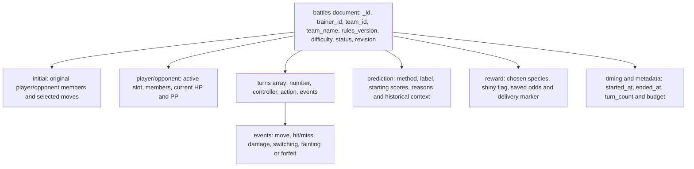

# MongoDB battle document model

This diagram explains fields already used by the application; it does not
define a new stored schema. Exact validation is in
[battle_validator.json](../../database/nosql/battle_validator.json), with
construction/update logic in [battle service](../../backend/battles/service.py).

- One document contains one battle. Turns and events are embedded arrays whose
  length/shape can vary; the simulator bounds play rather than permitting
  unbounded history growth within one battle.
- Initial snapshots and the starting prediction preserve battle-time facts.
  Normal turns update current state and append events; later saved-team edits
  do not change those original participants.
- SQL IDs are logical references. MongoDB does not enforce foreign keys to SQL;
  deleting a saved team does not delete the battle snapshot.
- `revision` plus active status is checked in the replacement filter so stale
  requests cannot both replace the same version.
- The validator checks required fields and selected types/enums. It does not
  express every nested game rule; application validation remains necessary.
- The `_id` index is inherently unique. Setup adds trainer/start-time ordering
  and a partial unique trainer index for active battles.
- The reward marker may be repaired after the SQL award commits. Document-level
  atomicity is separate from multi-row SQL atomicity and cross-store recovery.

For the report/video, show a real document from an isolated demonstration DB
and one actual aggregation result. The diagram is a model explanation, not
evidence that a particular sample battle or query was executed.
