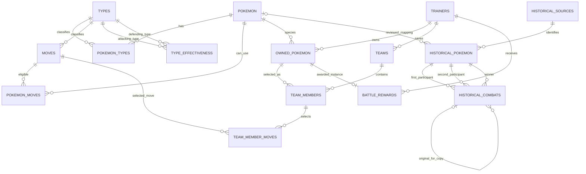

# Prototype relational relationships

Implemented in `database/relational/schema.sql` and the approved external-evidence extension `database/relational/historical.sql`. Composite ownership foreign keys ensure a team's members belong to that team's trainer.

- Team slots are 1–6, move slots 1–4 and Pokémon type slots 1–2.
- Draft teams may be empty. Battle entry requires 1–6 members and four distinct eligible moves each.
- A trainer can own multiple instances of a species. The same owned instance cannot appear twice in one team.
- `owned_pokemon.is_shiny` is a required Boolean defaulting to false, stored per owned instance rather than per species. Six normal and six shiny copies per non-legendary species are enforced for new application awards using a SQL aggregate under a trainer row lock. Legendary collection copies are unlimited; saving teams and starting battles permit only one of each legendary species across both variants. Existing entries are preserved. See [collection rules](../database-design/collection-rewards.md).
- Unique `(team_id, trainer_id)` and `(owned_id, trainer_id)` references enforce ownership in SQL.
- Server-side transactional validation checks move eligibility and the four-move requirement.
- `battle_rewards.battle_id` is unique and references a MongoDB battle UUID logically; cross-database foreign keys are not available.
- MongoDB stores immutable team snapshots for history, mutable HP/PP for play, and flexible turn events. Deleting a saved team does not delete its battle history.
- `historical_pokemon` uses `(source_id, external_id)` as its primary key; a nullable reviewed mapping points to the playable species. Alternate forms remain unmapped.
- `historical_combats` uses `(source_id, source_row)` and three composite participant/winner foreign keys. Its duplicate marker retains traceability; the importer validates duplicate lineage and default evidence excludes repeat copies. See the [historical design](../database-design/historical-import-proposal.md) for the tested enforcement limits.
- Historical source stats/results are preserved separately and do not overwrite the catalogue or MongoDB simulator history. Analysis views derive costs, defensive multipliers and ranked default moves without storing duplicate values.
